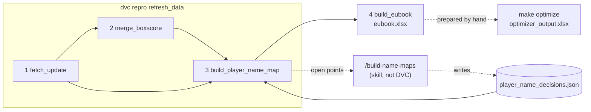

# indie-euroleague

- [Run guide](docs/run-guide.md) · [Optimizer](docs/optimizer.md) · [Rules of the game](docs/rules.md) · [Resources and links](docs/resources.md)

## Cheatsheet

Repo root. Every flag, stage and config key: [run guide](docs/run-guide.md). Steps: 1 fetch · 2 merge · 3 player names · 4 workbook.

```bash
# DVC (-s = just that stage; without it the upstream stages run too)
uv run dvc repro refresh_and_build_eubook     # 1+2+3+4
uv run dvc repro refresh_data                 # 1+2+3
uv run dvc repro fetch_update                 # 1 fetch: box score, fantasy stats, schedule (online)
uv run dvc repro -s merge_boxscore            # 2 merge (offline)
uv run dvc repro -s build_player_name_map     # 3 player map + names report (after /build-name-maps decisions)
uv run dvc repro -s build_eubook              # 4 workbook -> data/stage_03/eubook.xlsx (+ stage_99/eubook_<round>.xlsx)
uv run dvc repro fetch_kaggle                 # Kaggle history, separate from the update
# per-round fantasy stats: set fantasy_rounds = "1-6" in config/config.toml, then
uv run dvc repro fetch_euroleague_fantasy_stats

# Without DVC (same code)
uv run python -m eupy.transform.build_eubook  # 4 workbook
uv run python scripts/dataprep.py             # 4 working copy of build_eubook
uv run python -m eupy.optimize.optimize_squad # squad optimizer (same as make optimize)
```

Dev: `uv run pytest` · `uv run ruff check src tests && uv run ruff format --check src tests` · `uv run python -m eupy.registry check`

## Make targets

```bash
make optimize                    # squad optimizer: stage_04/optimizer_input.xlsx -> stage_99/optimizer_output.xlsx ([optimization] in config/config.toml)
make test                        # pytest
make check                       # lint via pre-commit
make clean-data                  # delete all git-ignored data (raw + stages); tracked files stay. ARGS=--dry-run lists only
make clean-data-raw              # raw data only
make clean-cache                 # caches (pycache, ruff, pytest, ...)
make clean-git                   # merged task branches/worktrees (ARGS=--yes / --dry-run)
make clean-all                   # clean-cache + clean-git (data is never included)
```

After `clean-data` run `uv run dvc repro refresh_and_build_eubook` to rebuild everything.

## Data flow



`refresh_and_build_eubook` = `refresh_data` + `build_eubook`. `fetch_kaggle` and `merge_headers` run on their own.

## Name matching

Fantasy stats (`C. Jones`, `PAO`) and the box score (`JONES, CARLIK`, `PAN`) spell players differently; the stats stay on the left of every join.

1. **Fetch**: stats, box score, schedule (the schedule gives the club codes).
2. **`build_player_name_map`** (DVC stage) matches exactly within the club, ignoring `Jr`/`IV`, and writes `data/stage_02/player_name_map.csv`.
3. **Report** (same stage): players in both; stats-only (not played yet, information); played but unlinked (warning, they drop out of the join).
4. **Mode** `names_mode` in `config/config.toml`: `continue` (default) goes on; `pause` exits 1 on unlinked players.
5. **`/build-name-maps`** (skill, run by you) records decisions in `src/eupy/entity/maps/player_name_decisions.json`; then `uv run dvc repro -s build_player_name_map`.
