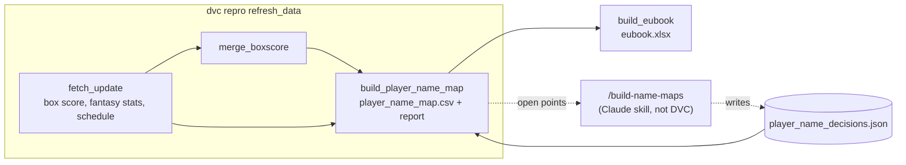

# indie-euroleague

- [Run guide](docs/run-guide.md)
- [Rules of the game](docs/rules.md)
- [Resources and links](docs/resources.md)

## Cheatsheet

Repo root. Every flag, stage and config key: [run guide](docs/run-guide.md).

```bash
uv run dvc repro refresh_and_build_eubook     # 1-4: fetch, merge, names, workbook
uv run dvc repro refresh_data                 # 1-3: the same without the workbook
uv run dvc repro fetch_update                 # fetch only: box score, fantasy stats, schedule
uv run dvc repro -s merge_boxscore            # merge only, offline
uv run dvc repro -s build_player_name_map     # player map + names report, e.g. after recording decisions (/build-name-maps)
uv run dvc repro -s build_eubook              # workbook only, offline (data/stage_03/eubook.xlsx)
uv run dvc repro fetch_kaggle                 # Kaggle history, separate from the update
```

Fantasy stats per round: set `fantasy_rounds = "1-6"` in `config/config.toml` (`"all"` = season average), then `uv run dvc repro fetch_euroleague_fantasy_stats`.

Dev: `uv run pytest` · `uv run ruff check src tests && uv run ruff format --check src tests` · `uv run python -m eupy.registry check`

## Make targets

```bash
make clean-data                  # delete all git-ignored data (raw + stages); tracked files stay. ARGS=--dry-run lists only
make clean-data-raw              # raw data only
make clean-cache                 # caches (pycache, ruff, pytest, ...)
make clean-git                   # merged task branches/worktrees (ARGS=--yes / --dry-run)
make clean-all                   # clean-cache + clean-git (data is never included)
make test                        # pytest
make check                       # lint via pre-commit
```

After `clean-data` run `uv run dvc repro refresh_and_build_eubook` to rebuild everything.

## Data flow

Each box is a DVC stage; `-s <stage>` runs just that stage, a plain `dvc repro <stage>` also runs everything upstream of it (fetchers always rerun).



`refresh_and_build_eubook` = `refresh_data` + `build_eubook`. `fetch_kaggle` (history) and `merge_headers` run on their own.

## Name matching: who does what

The fantasy stats (`C. Jones`, club `PAO`) are the left side of every join; the box score spells players `JONES, CARLIK` (club `PAN`), so the two must be linked first. In order:

1. **Fetch**: stats, box score and schedule. The schedule gives `TeamNames` (club codes).
2. **`build_player_name_map`** (DVC stage): reformats the box-score names and matches them exactly within the club, ignoring `Jr`/`IV`. Writes `data/stage_02/player_name_map.csv`: exact matches, open points, and the recorded decisions applied on top.
3. **Report** (printed by the same stage): players in both datasets; stats-only players (information, usually not played yet); box-score players who played but are not linked (warning: they drop out of the left join).
4. **Mode** (`names_mode` in `config/config.toml`, or `--mode`): `continue` (default) goes on; `pause` exits 1 after writing the map and stops the flow.
5. **`/build-name-maps`** (skill, run by you, not in DVC since DVC cannot call an agent): resolves open points into `src/eupy/entity/maps/player_name_decisions.json`. Then `uv run dvc repro -s build_player_name_map` rebuilds and reports again.
